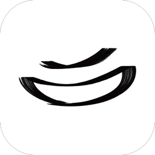
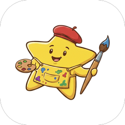

---

### 🚀 Projects

<table width="100%">

<tr>
<td width="64" align="center" valign="top">

</td>
<td valign="top">

**[WABI-SABI](https://github.com/ParkSiYeol3/wabi-sabi)** &nbsp;·&nbsp; 1인 개발 &nbsp;·&nbsp; [wasa.kr](https://wasa.kr) 운영 중

오래 곁에 두고 싶은 기물과 오브제를 큐레이션합니다

`Next.js` `TypeScript` `Supabase` `Tailwind` `Toss Payments` `Playwright` 대표님께 먼저 제안해 기획부터 운영까지 담당 &nbsp;·&nbsp; 2026.09 정식 운영 &nbsp;·&nbsp; 실제 주문을 받아 발송 중

</td>
</tr>

<tr>
<td width="64" align="center" valign="top">

</td>
<td valign="top">

**[Star-art](https://github.com/star-art-for-children/Frontend)** &nbsp;·&nbsp; 팀장 &nbsp;·&nbsp; KT Cloud TECH UP 2기 &nbsp;·&nbsp; [star-art.cloud](https://star-art.cloud)

아이들을 위한 3D 미술 전시회

`Next.js` `TypeScript` `three.js / R3F` `Supabase` `fal.ai` 작품 액자 · 아이 그림을 5초 영상으로 바꾸는 기능 · 스탬프 투어 · 관람 앨범 PDF &nbsp;·&nbsp; 4명으로 시작해 3명으로 완주

</td>
</tr>

<tr>
<td width="64" align="center" valign="top">

</td>
<td valign="top">

**[뭉치](https://github.com/V-MoongCheap/MoongCheap-frontend)** &nbsp;·&nbsp; 프론트엔드 파트장 &nbsp;·&nbsp; KT Cloud TECH UP 2기 통합 프로젝트 **대상**

뭉치면 싸진다 (수요 집결형 공동구매 플랫폼)

`Next.js 16` `React 19` `TypeScript` `Tailwind v4` `TanStack Query` `Zod` 8개 직군 통합 프로젝트 · 개발 환경과 폴더 구조 세팅 · 구매자 화면 API 연동 &nbsp;·&nbsp; 머지된 프론트엔드 PR 120건 중 67건

</td>
</tr>

<tr>
<td width="64" align="center" valign="top">

</td>
<td valign="top">

**[촌놈칩스](https://chonnomchips.vercel.app)** &nbsp;·&nbsp; 외주 &nbsp;·&nbsp; 3명 중 프론트엔드 담당 &nbsp;·&nbsp; 진행 중

감자칩 브랜드 촌놈칩스의 기업 사이트와 자사몰

`Next.js 16` `React 19` `TypeScript` `Tailwind v4` `GitHub Actions` `Playwright` 1안 화면을 나흘 동안 제작 · 클라이언트 피드백 두 번 반영 · 디자인 시안 직접 제작 &nbsp;·&nbsp; 머지된 PR 13건 중 10건 &nbsp;·&nbsp; 링크는 정식 공개 전 시연 주소

</td>
</tr>

<tr>
<td width="64" align="center" valign="top">

</td>
<td valign="top">

**[멘헤링](https://github.com/MENHERING/menhering-app)** &nbsp;·&nbsp; FE 4인 &nbsp;·&nbsp; KT Cloud TECH UP 2기

나만의 캐릭터와 함께하는 학습 습관 형성 PWA

`Next.js` `TypeScript` `Tailwind v4` `Zustand` `TanStack Query` `Supabase` `Serwist` 카카오 로그인 직접 구현 · 온보딩 · 홈 · 푸시 알림 · 사운드 &nbsp;·&nbsp; PR 66건 중 25건

</td>
</tr>

<tr>
<td width="64" align="center" valign="top">

</td>
<td valign="top">

**이거옷대여** &nbsp;·&nbsp; 4인 &nbsp;·&nbsp; 졸업 프로젝트 &nbsp;·&nbsp; 특허 출원

P2P 옷 대여 플랫폼

`React Native (Expo)` `JavaScript` `Node.js` `Firebase` 마이페이지 · 리뷰 · 찜 담당 &nbsp;·&nbsp; 특허 출원 10-2025-0071874 &nbsp;·&nbsp; 저작권 등록 C-2025-024297

</td>
</tr>

</table>

---

### 🏆 Awards

- **2026.10** &nbsp; KT Cloud TECH UP 2기 통합 프로젝트 **대상** (6팀 중 1위, 뭉치)
- **2026.10** &nbsp; KT Cloud TECH UP 2기 프론트엔드 **우수 수료생** (수료생 13명 중 1명)
- **2026.08** &nbsp; KT Cloud TECH UP 2기 아이디어톤 **최우수상** (6팀 중 2위, Safeshot)

---

### 🛠 Tech Stack

**Language**

  

**Frontend**

      

**Backend · DB**

   

**Payment · Test · Infra**

    

**AI**

  

---

